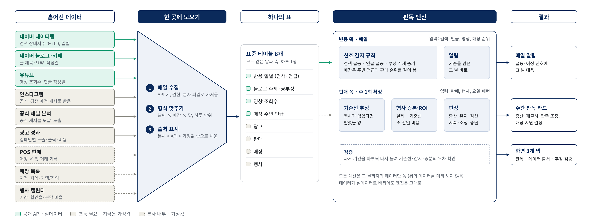

# 마케팅 판독 대시보드 (배라 마케팅 AX PoC)

SDIC × 넥스트페이먼츠 산학 「AI 전환(AX)을 통한 배스킨라빈스 마케팅 강화 전략」 PoC.

**판매, 광고, SNS 반응을 같은 날짜 축에 올려 주 단위로 판독하고, 평소와 다르게 튀는 신호는 그 날 바로 알림으로 띄우는 마케팅 의사결정 화면.**
새 수집 도구가 아니라, 흩어져 있던 데이터를 한 곳에 모아 같은 기준으로 읽게 해 주는 화면이다.

시연은 2026년 3월 이달의 맛 「두바이에서 온 엄마는 외계인」 출시를 날짜 순서대로 다시 재생한다.
슬라이더의 하루는 '그 날 밤까지 쌓인 데이터를 다음 날 아침에 본 모니터링'이고, 계산은 그 날까지의 데이터만 쓴다(테스트로 확인).

## 구조: 흩어진 데이터가 어떻게 한 곳에 모이고 엔진이 어떻게 도나



1. **한 곳에 모으기.** 형태가 제각각인 데이터(검색 상대지수, 블로그 글 목록, 영상 조회수, POS 거래, 행사표)를
   매일 수집해 **날짜 × 매장 × 맛, 하루 단위**로 맞춘다. 테이블마다 어디서 읽었는지 기록하고, 본사 데이터 > 공개 API > 가정값 순으로 채운다.
2. **하나의 표.** 모두 같은 날짜 축을 쓰는 표준 테이블 8개 (`pipeline/schema.py`). 본사 데이터도 이 모양으로 넣으면 된다.
3. **판독 엔진.** 두 갈래로 돈다.
   - 반응 쪽 (매일): 검색 급등, 언급 급증, 부정 주제 증가, 매장 이상을 규칙으로 감지해 그 날 알림.
   - 판매 쪽 (매주 월요일, 일요일까지 데이터): 기준선(행사가 없었다면 팔렸을 양) → 행사 증분·ROI → 판정(증산·유지·감산, 판촉 지속·조정·중단).
   - 검증: 과거 기간을 하루씩 다시 돌려 기준선·감지·증분의 오차를 본다.
4. **결과.** 매일 알림, 주간 판독 카드, 화면 탭.

데이터가 가정값에서 실데이터로 바뀌어도 엔진과 화면은 그대로다.

## 데이터 구분

| 구분 | 뜻 | 지금 화면의 값 | 해당 데이터 |
|---|---|---|---|
| 공개 API | 키만 있으면 받는 공개 데이터 | `.env`에 키를 넣고 수집하면 실제 값 | 네이버 데이터랩, 네이버 블로그·카페·뉴스, 유튜브 |
| 연동 필요 | 외부 플랫폼에 있지만 계정 연결이나 배라 권한이 있어야 받음 | 가정값 | 인스타그램(팀 비즈니스 계정 + 페이스북 페이지), 공식 채널 분석, 광고 성과 |
| 본사 내부 | 배라 내부 시스템에만 있어 외부에서 접근 불가 | 같은 형식의 가정값 | POS 판매, 매장 목록, 행사 캘린더·분담 |

가정값은 공개 수치에 맞췄다: 출시일 2/24(실데이터 정점·소비자 게시물), 누적 판매(출시 15일 100만 개, 22일 142만 개, 언론 보도),
가맹점 1,713개(정보공개서), 행사 일정·혜택(보도. 행마다 근거 링크와 확인 수준을 단다).
무엇이 근거 있고 무엇이 가정인지는 [docs/DATA.md](docs/DATA.md).

## 공개 API로 모으는 것

기간은 **2025-11-01 ~ 2026-03-31** (두쫀쿠 유행 시작 무렵부터 배라 출시 달 말까지). 검색어와 기간은 `pipeline/config.py`의 `Collect` 한 곳에서 바꾼다.

| 소스 | 검색어 | 가져오는 것 | 화면에서 |
|---|---|---|---|
| 네이버 데이터랩 | 배라 신제품 8개 표기(배스킨라빈스·베스킨라빈스·배스킨라벤스·베스킨라벤스 두바이, 배라·베라 두바이, 두바이(에서 온) 엄마는 외계인) / 업계 유행("두바이 쫀득쿠키", "두바이쫀득쿠키", "두쫀쿠") | 날짜별 검색 관심도(0~100). 그룹 안 검색어는 합산되고, 두 그룹을 한 요청으로 받아 같은 기준으로 비교 | 타임라인 맨 위 줄 |
| 네이버 블로그 | 배라 신제품 검색어 7개 × 정확도순·최신순 (각 최대 1,000건) | 글 제목·요약·작성일. '두바이'와 '배스킨·베스킨·라빈스·라벤스·배라·베라·엄마는 외계인' 중 하나가 같이 나온 글만 | 날짜별 언급 수, 긍정률, 주제별 반응 |
| 네이버 카페 | 배라 신제품 검색어 3개 | 전체 글 수만 (카페는 작성일을 주지 않음) | 데이터 출처 기록 |
| 네이버 데이터랩 (행사명) | 브랜드("배스킨라빈스" 등) / 배라위크 / 31데이 | 행사명 검색 관심도. 행사 기간이 평소(시작 전 4주 중앙값)의 몇 배였나 | 행사표의 '행사명 검색 n배' |
| 네이버 뉴스 | 이달의 맛, 배라위크, 31데이, 프로모션·할인, 신제품명 등 10개 | 기사 제목·요약·게시일 → 행사 이름·기간·혜택, 회사가 발표한 성과 수치("15일 만에 100만 개") | 행사표의 '기사 n건', 공개 앵커 확인 |
| 유튜브 | "배스킨라빈스 두바이", "두바이에서 온 엄마는 외계인", "배라 두바이", "베라 두바이" (2/15~3/31 게시) | 영상 제목, 공식·소비자 구분, 게시일, 지금 시점 조회수 + 상위 10개 영상 댓글의 작성일. 제목·설명·태그에 배라 표기가 없는 영상(일반 '두바이 초콜릿' 영상 등)은 뺀다 | 영상 목록, 날짜별 댓글 흐름 |

배라는 표기가 섞여 쓰인다(배라·베라, 배스킨라빈스·베스킨라빈스·배스킨라벤스). 검색어와 글 거르기에 이 표기들을 모두 넣었다.
검색어가 늘면 호출도 는다: 블로그는 검색어당 최대 20회(정확도순·최신순 각 10회), 유튜브 검색은 1회 100 units. 한 번 수집에 네이버 약 350회(뉴스 포함), 유튜브 약 500 units로 무료 한도 안이다.

알아 둘 한계:
- 블로그는 검색어당 1,000건이 상한이라 언급 수는 하한값이다. 두쫀쿠처럼 큰 유행은 크기를 데이터랩으로 본다.
- 유튜브는 과거 날짜별 조회수를 주지 않는다. 지나간 기간 화면에는 '그 날까지 올라온 영상 + 수집일 기준 조회수'가 나온다.
- 유튜브 정책상 API 수치로 새 지표를 만들지 않고, 30일 넘게 저장하지 않는다. 발표 전에 다시 수집해 갱신한다.
- 뉴스 API는 기사 본문 없이 요약만 준다. 요약에 날짜가 없으면 행사 규칙(배라위크 셋째 월요일, 31데이 31일)으로 채우고 '규칙 추정'으로 표시한다.
  성과 수치는 회사가 발표한 것만 나온다(잘된 행사만 보도됨). 판매 증분·ROI는 본사 데이터로 본다.
- 날짜는 모두 한국 시간 기준이다(유튜브는 UTC로 와서 바꿔 센다).

### 정제

- **원문 보관**: 블로그·뉴스·유튜브 원문(제목·요약·링크·날짜)을 `data/collected/raw/{소스}_{수집일}.jsonl`에 남긴다. 30일 지나면 지운다.
  집계값이 왜 그렇게 나왔는지 글 단위로 다시 볼 수 있다. 블로그 원문에는 거르기 결과(`relevant`)도 같이 적는다.
- **관련성**: 블로그는 '두바이' + 배라 표기, 유튜브는 제목·설명·태그·채널명에 배라 표기, 뉴스는 배라 표기가 있는 기사만.
- **중복**: 블로그·뉴스는 원문 링크 기준, 같은 보도자료를 받아 쓴 기사는 행사 하나로 묶어 기사 수·매체 수를 따로 센다.
- **작은 표본**: 긍정률·주제 비중은 구간 건수를 합쳐 비교하고, 건수가 적거나 차이가 우연 범위(z < 2)면 알림을 내지 않는다.
  매장 알림은 이틀 연속 걸린 매장만.
- **섞임 방지**: 공개 API로 받은 (소스, 키워드)는 지표 전체를 API 값으로 쓴다. 가정값 지표를 끼워 넣지 않는다.

## 로컬에서 돌리기

필요한 것: Python 3.11 이상, Node 20 이상, Git.

### 1. 받기

```bash
git clone https://github.com/aventador700404/Baera-Industry-Academic-Cooperation-Team-1.git
cd Baera-Industry-Academic-Cooperation-Team-1
git checkout poc-api-hub          # main에 합치기 전까지는 이 브랜치
cd poc-realtime-readout
```

### 2. 설치와 키

macOS / Linux

```bash
make setup                        # .venv + pip, web npm ci
cp .env.example .env              # .env 를 열어 키 입력
```

Windows (PowerShell)

```powershell
python -m venv .venv
.venv\Scripts\Activate.ps1
pip install -r requirements.txt
cd web; npm ci; cd ..
copy .env.example .env            # 메모장으로 .env 를 열어 키 입력
$env:PYTHONUTF8 = "1"             # 한글 출력이 깨지지 않게 (창마다 한 번)
```

`.env`에 넣을 것:

```
NAVER_CLIENT_ID=...        # 네이버클라우드 NAVER API HUB 의 Client ID
NAVER_CLIENT_SECRET=...    # 같은 곳의 Client Secret
YOUTUBE_API_KEY=...        # Google Cloud 의 YouTube Data API v3 키
```

예전 네이버 개발자센터 키라면 `NAVER_API_MODE=openapi`를 한 줄 더 넣는다. `.env`는 `.gitignore`에 있어 커밋되지 않는다.

### 3. 키 점검 → 수집 → 화면

| 할 일 | macOS / Linux | Windows |
|---|---|---|
| 키마다 한 번씩 호출해 보기 | `make check-apis` | `python -m pipeline.collect.run --check` |
| 수집 + 판독 JSON 만들기 | `make live` | `python -m pipeline.mock.generate`<br>`python -m pipeline.collect.run`<br>`python -m pipeline.build` |
| 화면 띄우기 | `make dev` 대신 `cd web && npm run dev` | `cd web; npm run dev` |
| 테스트 | `make test` | `python -m pytest` |

화면은 http://127.0.0.1:5173. (`make dev`는 가정값으로 다시 빌드하므로, 실데이터를 본 뒤에는 `npm run dev`만 쓴다.)

수집 결과는 `data/collected/`에 쌓이고(집계 CSV, 뉴스에서 뽑은 `news_events.csv`·`news_claims.csv`, 원문 `raw/`),
무엇을 몇 건 받았는지와 실패 이유는 `data/collected/_collect_log.json`에 남는다.
API 하나가 실패해도 나머지는 계속 모으고, 오류 문구에서는 키를 지운다. 빌드 끝에 찍히는 `데이터 출처:` 줄에서
`reaction_daily: 공개 API + 목`처럼 바뀌었으면 실데이터가 들어간 것이다.

### 4. 배포 화면(Vercel)에 반영

Vercel은 파이썬을 돌리지 않고 `web/public/data/readout.json`만 읽는다. 수집·빌드 후 이 파일을 커밋해 올리면 반영된다.
수집 원본(`data/collected/*.csv`)은 올리지 않는다. 유튜브 수치가 들어간 JSON은 30일 안에 다시 수집해 갱신한다.

## 화면

- 상단 바: 기준일(날짜 슬라이더 + ▶ 기간 재생 + 판독일 바로가기)
- 핵심 지표: 누적 판매, 첫 주 목표 대비, 검색지수, 블로그 언급, 긍정률, 광고 노출·클릭률, 반응 대비 판매
- 통합 타임라인: 판매 · 광고 · SNS 반응을 같은 날짜 축에 세 줄로
- 4개 모듈과 오른쪽 알림 피드

| 모듈 | 보는 것 | 데이터 |
|---|---|---|
| 신제품 반응 | 주제별 언급과 긍부정, 반응을 끈 영상, 반응 대비 판매 | 공개 API |
| 맛별 판매 순위 | 7일 일평균 순위, 원조 잠식, 첫 주 목표 대비 → 증산·재출시 | 본사 내부 (가정값) |
| 매장 순위 급등 | 순위 변화를 매장 주변 언급으로 판독 (언급↑ 판매↓ = 품절 의심, 둘 다↑ = 바이럴) | 본사 내부 + 공개 API |
| 판촉 행사 효과 | 기준선을 뺀 증분, 증분 ROI → 지속·조정·중단 | 본사 내부 (가정값) |

다음 단계: 데이터 출처 탭, 지표별 구분 배지, 추정 검증 탭, 출시일 보정(보도 기준 2월 말).

## 폴더

```
pipeline/            파이썬: 데이터 → 하루씩 모니터링·주간 판독 → JSON (계산 로직은 전부 여기)
  config.py          출시일·목표·판정 기준 + 수집 범위·검색어(Collect)
  schema.py          데이터 계약 (표준 테이블 8개). 본사 데이터는 이 모양으로 넣는다
  io.py              읽기 우선순위: data/raw(본사) > data/collected(API) > data/generated(가정값)
  mock/generate.py   가정값 (공개 수치에 맞춤, 감지돼야 할 사건을 심어 둠, 정답은 _truth.json)
  collect/           네이버(API HUB 기본) 데이터랩·블로그·카페, 유튜브, 인스타 수집기 + 수집 기록
  analysis/          alerts(감지) · reaction · flavor · stores · promo · baseline · cards
  build.py           슬라이더의 하루마다 계산 + 월요일 판독 카드 → web/public/data/readout.json
web/                 React + Vite + TypeScript + Chart.js. JSON만 읽어서 그린다 (정적 파일)
tests/               pytest (네트워크 없이 수집 전 과정, 키 누출 방지 포함)
docs/                ARCHITECTURE · DATA · CONTEXT, img/data-flow (구조도 원본 HTML 포함)
```

## 문서

- [docs/CONTEXT.md](docs/CONTEXT.md) — 왜 이 화면인가, 시연 흐름, 본사에 확인할 것
- [docs/ARCHITECTURE.md](docs/ARCHITECTURE.md) — 감지 규칙, 계산 방법, 실제 운영으로 넘어갈 때
- [docs/DATA.md](docs/DATA.md) — 테이블 계약, API 한도와 정책, 가정값과 심어 둔 사건
